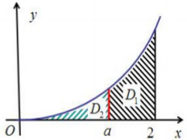

八、(满分8分) 设 $D_{1}$ 是抛物线 $y = 2x^{2}$ 和直线 $x = a, x = 2$

及 y=0 所围成的平面区域； $D_{2}$ 是抛物线 $y=2x^{2}$ 和直线

x = a, y = 0 所围成的平面区域，其中 0 < a < 2.

(1) $D_{1}$ 绕 $x$ 轴旋转而成的旋转体的体积为 $V_{1}$; $D_{2}$ 绕 $y$ 轴旋转而成的旋转体的体积为 $V_{2}$, 求 $V_{1}$

和 $V_{2}$ ; (2) 当 a 为何值时， $V_{1} + V_{2}$ 取得最大值，并求出最大值.
