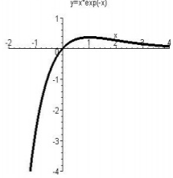

解:（1）∵ $f'(x)=(1-x)e^{-x}\begin{cases}>0,\quad x<1,\\=0,\quad x=1,\\<0,\quad x>1,\end{cases}$ 2 分

∴ $f(x)\in\uparrow(-\infty,1),f(x)\in\downarrow(1,+\infty)$ ，且极大值为 $f_{\max}=f(1)=\frac{1}{e}$ . 4 分

(2) $x = ae^{x}$ 的实根个数 $\Leftrightarrow y = xe^{-x}$ 与 $y = a$ 的交点个数. 由（1）及 $\lim_{x\to -\infty}f(x) = \lim_{x\to -\infty}\frac{x}{e^x} = -\infty ((-\infty)\cdot (+\infty))$ ，$\lim_{x\to +\infty}f(x) = \lim_{x\to +\infty}\frac{x}{e^x} = \lim_{x\to +\infty}\frac{1}{e^x} = 0,$ 可知 ① 当 $a\leq 0$ 或 $a = \frac{1}{e}$ 时，原方程只有一个实根；② 当 $0 < a < \frac{1}{e}$ 时，原方程有两个实根；③ 当 $a > \frac{1}{e}$ 时，原方程没有实根.

