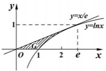
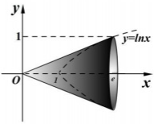

解:(I) $\because y' = \frac{1}{x}, y'(e) = \frac{1}{e}$,

∴切线方程为 $y-1=\frac{1}{e}(x-e)$ ，即 $y=\frac{x}{e}$ .

$$
A = \frac {e}{2} - \int_ {1} ^ {e} \ln x d x = \frac {e}{2} - [ x (\ln x - 1) ] _ {1} ^ {e} = \frac {e}{2} - 1.
$$

$$
\begin{array}{r l} \text {(II)} V & = \frac {1}{3} \pi e - \pi \int_ {1} ^ {e} \ln^ {2} x d x = \frac {1}{3} \pi e - \pi [ x \ln^ {2} x | _ {1} ^ {e} - \int_ {1} ^ {e} x \cdot 2 \ln x \cdot \frac {1}{x} d x ] \\ & = \frac {1}{3} \pi e - \pi (e - 2 \int_ {1} ^ {e} \ln x d x) = \frac {1}{3} \pi e - \pi [ e - 2 x (\ln x - 1) | _ {1} ^ {e} ] \\ & = \frac {1}{3} \pi e - \pi (e - 2) = 2 \pi (1 - \frac {e}{3}). \end{array}
$$

