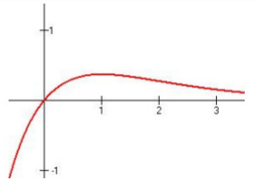

$\lim_{x\to +\infty}f(x) = \lim_{x\to +\infty}\frac{x}{e^x} = \lim_{x\to +\infty}\frac{1}{e^x} = 0,$ 可知 $①$ 当 $a\leq 0$ 或 $a = \frac{1}{e}$ 时，原方程只有一个实根；$②$ 当 $0 < a < \frac{1}{e}$ 时，原方程有两个实根；$③$ 当 $a > \frac{1}{e}$ 时，原方程没有实根.

