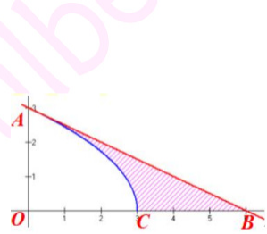

解:由已知，有 $2y\cdot y^{\prime} = -3$ ，因此， $y^{\prime}(0) = -\frac{1}{2}$ 所以，过(0,3)的切线方程为: $y - 3 = -\frac{1}{2} x$ 该切线与 $\pmb{x}$ 轴的交点坐标为(6,0).因此， $V = \frac{1}{3}\pi \cdot 3^{2}\cdot 6 - \pi \int_{0}^{3}y^{2}dx.$ $= 18\pi -\frac{27}{2}\pi = \frac{9\pi}{2}.$

