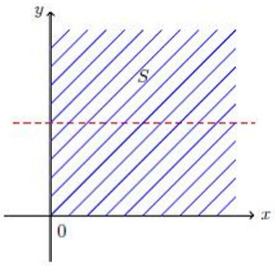

解:（1）如图所示，可得

$$
\begin{array}{r l} 1 & = \int_ {- \infty} ^ {+ \infty} \int_ {- \infty} ^ {+ \infty} f (\mathrm{x}, \mathrm{y}) \mathrm{dxdy} \\ & = \int_ {0} ^ {+ \infty} \int_ {0} ^ {+ \infty} A e ^ {- (\mathrm{x} + \mathrm{y})} \mathrm{dxdy} \\ & = \int_ {0} ^ {+ \infty} \left[ \int_ {0} ^ {+ \infty} A e ^ {- (\mathrm{x} + \mathrm{y})} d x \right] d y \\ & = \int_ {0} ^ {+ \infty} A e ^ {- \mathrm{y}} d y \\ & = A \end{array}
$$

所以，A=1.

