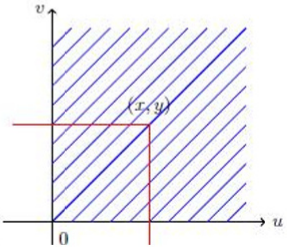

（2）如图所示，

①当 $x\leq0$ 或 $y\leq0$ ， $F(x,y)=0$ .

②当 $x > 0$ ， $y > 0$

$$
\begin{array}{r l} F (x, y) & = \mathrm{P} (\mathrm{X} \leq \mathrm{x}, \mathrm{Y} \leq \mathrm{y}) = \int_ {- \infty} ^ {x} \int_ {- \infty} ^ {y} f (\mathrm{u}, \mathrm{v}) d u d v \\ & = \int_ {0} ^ {x} \int_ {0} ^ {y} e ^ {- (\mathrm{u} + \mathrm{v})} d u d v = \int_ {0} ^ {y} \left[ \int_ {0} ^ {x} e ^ {- (\mathrm{u} + \mathrm{v})} d u \right] d v \\ & = (1 - \mathrm{e} ^ {- x}) (1 - \mathrm{e} ^ {- y}) \end{array}
$$

所以联合分布函数为

$$
F (x, y) = \left\{ \begin{array}{c c} (1 - \mathrm{e} ^ {- x}) (1 - \mathrm{e} ^ {- y}), & x > 0, y > 0 \\ 0, & \text {其他} \end{array} \right.
$$

(3) $P(X>1)=1-P(X\leq1)$

$$
\begin{array}{l} = 1 - P (X \leq 1, Y < + \infty) \\ = 1 - F (1, + \infty) \\ = e ^ {- 1} \end{array}
$$

