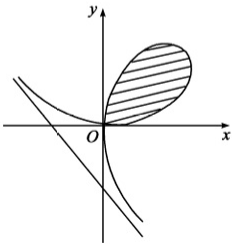

【解】（1）斜渐近线的方程为: $y=kx+b$ ，其中 $k=\lim_{x\to\infty}\frac{y}{x}$ ， $b=\lim_{x\to\infty}(y-kx)$ .
由 $x^{3}+y^{3}-\frac{3}{2}xy=0$ 得， $1+\left(\frac{y}{x}\right)^{3}-\frac{3}{2x}\cdot\frac{y}{x}=0$ 。两边取极限 $x\to\infty$ ，得 $k=\lim_{x\to\infty}\frac{y}{x}=-1$ 。
…… 3 分令 $t = y + x$ ，则 y = t - x，代入 C 的方程并整理，得 $\frac{t^{3}}{3x^{2}} - \frac{t^{2}}{x} + t - \frac{t}{2x} = -\frac{1}{2}$ 。两边取极限 $x \to \infty$ ，注意到 $t \to b$ ，得 $b = -\frac{1}{2}$ 。
因此，曲线 C 的斜渐近线方程为 $x + y + \frac{1}{2} = 0$ 。…… 4 分

(2) 采用极坐标计算所求面积.

曲线 C 的方程可用极坐标表示为

$r = \frac{3}{2} \cdot \frac{\cos \theta \sin \theta}{\cos^3 \theta + \sin^3 \theta} \left(0 \leq \theta \leq \frac{\pi}{2}\right)$, 围成的平面图形如图所示. 故所求面积为 $A = \frac{1}{2} \int_{0}^{\frac{\pi}{2}} [r(\theta)]^2 \, \mathrm{d}\theta = \frac{9}{8} \int_{0}^{\frac{\pi}{2}} \frac{\cos^2 \theta \sin^2 \theta}{(\cos^3 \theta + \sin^3 \theta)^2} \, \mathrm{d}\theta$ 4 分 $= \frac{9}{8} \int_{0}^{\frac{\pi}{2}} \frac{\tan^2 \theta \mathrm{d}(\tan \theta)}{(1 + \tan^3 \theta)^2} = \frac{9}{8} \cdot \left(-\frac{1}{3} \cdot \frac{1}{1 + \tan^3 \theta}\right)_0^{\frac{\pi}{2}}$ $= \frac{3}{8}$. 3 分

