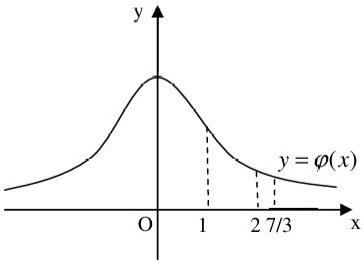

【答案】A

【解析】

$$
p _ {1} = P \{- 2 \leq X _ {1} \leq 2 \} = \Phi (2) - \Phi (- 2) = 2 \Phi (2) - 1,
$$

$$
p _ {2} = P \{- 2 \leq X _ {2} \leq 2 \} = P \left\{\frac {- 2 - 0}{2} \leq \frac {X _ {2} - 0}{2} \leq \frac {2 - 0}{2} \right\} = \Phi (1) - \Phi (- 1) = 2 \Phi (1) - 1,
$$

$$
p _ {3} = P \{- 2 \leq X _ {3} \leq 2 \} = P \left\{\frac {- 2 - 5}{3} \leq \frac {X _ {3} - 5}{3} \leq \frac {2 - 5}{3} \right\} = \Phi (- 1) - \Phi \left(- \frac {7}{3}\right) = \Phi \left(\frac {7}{3}\right) - \Phi (1),
$$

由下图可知， $p_{1}>p_{2}>p_{3}$ ，选A.

