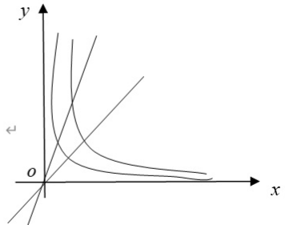

【答案】(B)
【分析】此题考查将二重积分化成极坐标系下的累次积分
【解析】先画出D的图形，

所以 $\iint_{D}f(x,y)dxdy = \int_{\frac{\pi}{4}}^{\frac{\pi}{3}}d\theta \int_{\frac{1}{\sqrt{2\sin 2\theta}}}^{\frac{1}{\sqrt{\sin 2\theta}}}f(r\cos \theta ,r\sin \theta)rdr,$ 故选（B）

