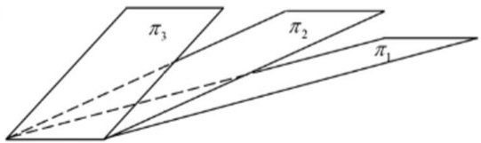

在空间直角坐标系 O-xyz 中，三张平面 $\pi_{i}: a_{i}x + b_{i}y + c_{i}z = d_{i}$

$(i = 1,2,3)$ 位置关系如图所示，记 $\pmb{\alpha}_{i} = (a_{i},b_{i},c_{i}),\pmb{\beta}_{i} = (a_{i},b_{i},c_{i},d_{i}),$

若 $r\left( \begin{array}{c}\pmb {\alpha}_{4}\\ \pmb {\alpha}_{2}\\ \pmb{\alpha}_{3} \end{array} \right) = m,r\left( \begin{array}{c}\pmb {\beta}_{1}\\ \pmb {\beta}_{2}\\ \pmb {\beta}_{3} \end{array} \right) = n$ ，则

5.

(A) $m = 1, n = 2$
