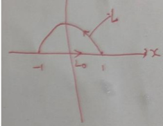

【答案】 $\frac{4}{3} -2\sin 1$

【解析】由题易知可作曲线如右图所示.

记 $L_{0}$ 是从 x = -1 到 x = 1 的直线,

并记曲线积 $I = \int_{L}(y + \cos x)dx + (2x + \cos y)dy$

则在 $L_{0}$ 与 $L$ 所围的封闭区域可用格林公式即 $I_{1} = \oint_{L_{0} + L}(y + \cos x)dx + (2x + \cos y)dy$

$$
= \iint_ {D} 2 - 1 d \sigma = \int_ {- 1} ^ {1} d x \int_ {0} ^ {1 - x ^ {2}} d y = \int_ {- 1} ^ {1} (1 - x ^ {2}) d x = \frac {4}{3}
$$

又 $I_{2} = \int_{L_{0}}(y + \cos x)dx + (2x + \cos y)dy = \int_{-1}^{1}\cos xdx = 2\sin 1$ ，故 $I = \frac{4}{3} -2\sin 1$
