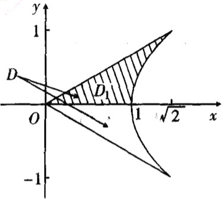

(16)【解】由题设知积分区域 $D$ 的上边界是直线 $x - \sqrt{2} y = 0$，下边界是直线 $x + \sqrt{2} y = 0$，它们相交于坐标原点 $(0,0)$，而 $D$ 的右边界则是双曲线 $x^{2} - y^{2} = 1$ 的右支 $x = \sqrt{1 + y^{2}}$，如图所示。

注意积分区域 $D$ 关于 $x$ 轴对称，记 $D_{1}$ 为 $D$ 在 $y \geqslant 0$ 半平面的部分区域，则 $D_{1} = \{(x, y) \mid 0 \leqslant y \leqslant 1, \sqrt{2} y \leqslant x \leqslant \sqrt{1 + y^{2}}\}$，于是所求二重积分

$$
\begin{array}{r l} I & = \iint_ {D} (x + y) ^ {3} \mathrm{d} x \mathrm{d} y = \iint_ {D} (x ^ {3} + 3 x ^ {2} y + 3 x y ^ {2} + y ^ {3}) \mathrm{d} x \mathrm{d} y \\ & = \iint_ {D} (x ^ {3} + 3 x y ^ {2}) \mathrm{d} x \mathrm{d} y + \iint_ {D} (3 x ^ {2} y + y ^ {3}) \mathrm{d} x \mathrm{d} y. \end{array}
$$

由于 $x^{3} + 3xy^{2}$ 关于 $y$ 是偶函数，而 $3x^{2}y + y^{3}$ 关于 $y$ 是奇函数，所以

$$
\begin{array}{l} I = 2 \iint_ {D _ {1}} (x ^ {3} + 3 x y ^ {2}) \mathrm{d} x \mathrm{d} y + 0 = 2 \int_ {0} ^ {1} \mathrm{d} y \int_ {\sqrt {2} y} ^ {\sqrt {1 + y ^ {2}}} (x ^ {3} + 3 x y ^ {2}) \mathrm{d} x \\ = 2 \int_ {0} ^ {1} \left(\frac {x ^ {4}}{4} + \frac {3}{2} x ^ {2} y ^ {2}\right) \Bigg | _ {x = \sqrt {2} y} ^ {x = \sqrt {1 + y ^ {2}}} \mathrm{d} y \\ = 2 \int_ {0} ^ {1} \left[ \frac {(1 + y ^ {2}) ^ {2} - (\sqrt {2} y) ^ {4}}{4} + \frac {3}{2} y ^ {2} (1 + y ^ {2} - 2 y ^ {2}) \right] \mathrm{d} y \\ = \int_ {0} ^ {1} \left[ \frac {1}{2} (1 + 2 y ^ {2} - 3 y ^ {4}) + 3 y ^ {2} (1 - y ^ {2}) \right] \mathrm{d} y \\ = \frac {1}{2} (1 + \frac {2}{3} - \frac {3}{5}) + 3 (\frac {1}{3} - \frac {1}{5}) = \frac {8}{1 5} + \frac {6}{1 5} = \frac {1 4}{1 5}. \end{array}
$$
