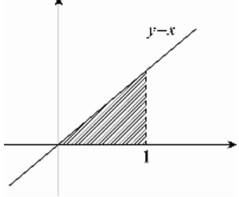

【解析】积分区域如右图

$$
\begin{array}{r l} \text {原式} & = \int_ {0} ^ {1} d y \int_ {y} ^ {1} \frac {e ^ {x ^ {2}}}{x} d x - \int_ {0} ^ {1} d y \int_ {y} ^ {1} e ^ {y ^ {2}} d x \\ & = \int_ {0} ^ {1} d x \int_ {0} ^ {x} \frac {e ^ {x ^ {2}}}{x} d y - \int_ {0} ^ {1} \left(e ^ {y ^ {2}} x \Big | _ {y} ^ {1}\right) d y \\ & = \int_ {0} ^ {1} e ^ {x ^ {2}} d x - \int_ {0} ^ {1} e ^ {y ^ {2}} (1 - y) d y \\ & = \int_ {0} ^ {1} e ^ {x ^ {2}} d x - \int_ {0} ^ {1} e ^ {y ^ {2}} + \int_ {0} ^ {1} y e ^ {y ^ {2}} d y \\ & = \frac {1}{2} \int_ {0} ^ {1} e ^ {y ^ {2}} d y ^ {2} = \frac {1}{2} e ^ {y ^ {2}} \Big | _ {0} ^ {1} = \frac {1}{2} (e - 1) \end{array}
$$
