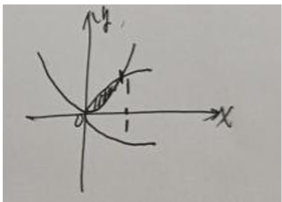

解:

$\iint_{D}(x - y + 1)^{2}dxdy = \iint_{D}\left((x - y)^{2} + 2(x - y) + 1\right)dxdy$

数学试题第8页

由轮换对称性

$$
\iint_ {D} (x - y) d x d y = \iint_ {D} (y - x) d x d y = 0.
$$

$$
\iint_ {D} (x - y) ^ {2} d x d y = \int_ {0} ^ {1} d x \int_ {x ^ {2}} ^ {\sqrt {x}} (x - y) ^ {2} d y = \int_ {0} ^ {1} \frac {1}{3} (y - x) ^ {3} \Bigg | _ {x ^ {2}} ^ {\sqrt {x}} d x
$$

$$
= \frac {1}{3} \int_ {0} ^ {1} f \left[ (\sqrt {x} - x) ^ {3} - (x ^ {2} - x) ^ {3} \right] d x = \frac {1}{3} \times \frac {1}{7 0} = \frac {1}{2 1 0}
$$

$$
1 d x d y = \begin{array}{l} _ 0 ^ {1} d x \end{array} _ {x ^ {2}} ^ {\sqrt {x}} d y = \begin{array}{l} _ 0 ^ {1} \sqrt {x} - x ^ {2} d x = \frac {2}{3} - \frac {1}{3} = \frac {1}{3} \end{array}
$$

则原积分 $= \frac{1}{210} +\frac{1}{3} = \frac{71}{210}$
