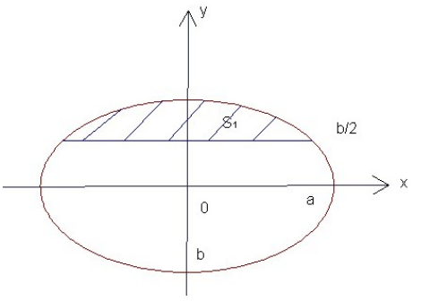

(18)【解析】油罐放平, 截面如图建立坐标系之后, 边界椭圆的方程为:

$$
\frac {x ^ {2}}{a ^ {2}} + \frac {y ^ {2}}{b ^ {2}} = 1\left. \right|
$$

阴影部分的面积

$$
S = \int_ {- b} ^ {\frac {b}{2}} 2 x d y = \frac {2 a}{b} \int_ {- b} ^ {\frac {b}{2}} \sqrt {b ^ {2} - y ^ {2}} d y
$$

