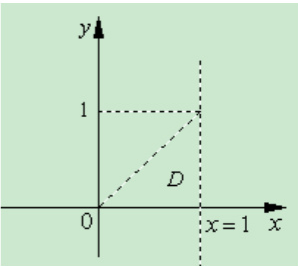

(20)【解析】 $I=\iint_{D}r^{2}\sin\theta\sqrt{1-r^{2}\cos2\theta}drd\theta$

 $=\iint_{D}r\sin\theta\sqrt{1-r^{2}\left(\cos^{2}\theta-\sin^{2}\theta\right)}\cdot rdrd\theta$

 $=\iint_{D}y\sqrt{1-x^{2}+y^{2}}dxdy$

 $=\int_{0}^{1}dx\int_{0}^{x}y\sqrt{1-x^{2}+y^{2}}dy=\int_{0}^{1}\frac{1}{3}\left[1-(1-x^{2})^{\frac{3}{2}}\right]dx$

 $=\int_{0}^{1}\frac{1}{3}dx-\frac{1}{3}\int_{0}^{1}(1-x^{2})^{\frac{3}{2}}dx=\frac{1}{3}-\int_{0}^{\frac{\pi}{2}}\cos4\theta d\theta=\frac{1}{3}-\frac{3}{16}\pi.$

