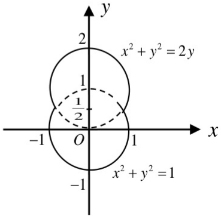

(20) (本题满分 11 分)

一容器的内侧是由图中曲线绕 $y$ 轴旋转一周而成的曲面，该曲线由$x^{2} + y^{2} = 2y(y\geq \frac{1}{2})$ 与 $x^{2} + y^{2} = 1(y\leq \frac{1}{2})$ 连接而成的.

(I) 求容器的容积;

（II）若将容器内盛满的水从容器顶部全部抽出，至少需要做多少功？（长度单位: $m$ ，重力加速度为 $gm / s^2$ ，水的密度为 $10^{3}kg / m^{3}$ ）.

图1
