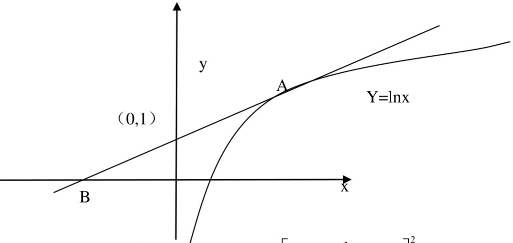

【解析】:

设切点坐标为 $A(x_0, \ln x_0)$，斜率为 $\frac{1}{x_0}$，所以设切线方程为 $y - \ln x_0 = \frac{1}{x_0} (x - x_0)$，又因为该切线过 $B(0,1)$，所以 $x_0 = e^2$，故切线方程为:$y = \frac{1}{e^2} x + 1$

切线与 $x$ 轴交点为 $B\left(-e^2,0\right)$

$$
A = \int_ {0} ^ {2} \left[ e ^ {y} - e ^ {2} (y - 1) \right] d y = \left[ e ^ {y} - e ^ {2} (\frac {1}{2} y ^ {2} - y) \right] _ {0} ^ {2} = e ^ {2} - 1
$$

(2)

$$
\begin{array}{r l} V & = \frac {1}{3} \pi \cdot 2 ^ {2} \cdot \left[ e ^ {2} - \left(- e ^ {2}\right) \right] - \pi \int_ {1} ^ {e ^ {2}} \ln^ {2} x d x \\ & = \frac {8}{3} \pi e ^ {2} - \pi \left[ \left(x \ln^ {2} x\right) _ {1} ^ {e ^ {2}} - \int_ {1} ^ {e ^ {2}} 2 \ln x d x \right] \\ & = \frac {8}{3} \pi e ^ {2} - \pi \left[ 4 e ^ {2} - \left(2 x \ln x\right) _ {1} ^ {e ^ {2}} + \int_ {1} ^ {e ^ {2}} 2 d x \right] \\ & = \frac {8}{3} \pi e ^ {2} - 2 \pi \left(e ^ {2} - 1\right) = \frac {2}{3} \pi \left(e ^ {2} + 3\right) \end{array}
$$
