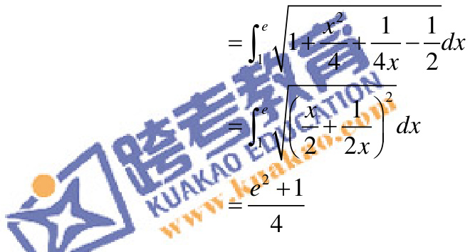

(2) 由形心的计算公式可得, $D$ 的形心的横坐标为

$$
\frac {\int_ {1} ^ {e} x \left(\frac {1}{4} x ^ {2} - \frac {1}{2} \ln x\right) d x}{\int_ {1} ^ {e} \left(\frac {1}{4} x ^ {2} - \frac {1}{2} \ln x\right) d x} = \frac {3 \left(e ^ {4} - 2 e ^ {2} - 3\right)}{4 \left(e ^ {3} - 7\right)}
$$
