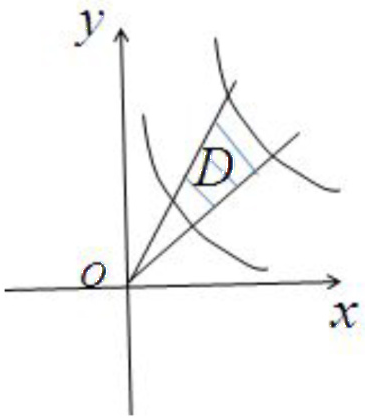

【答案】(B)

【解析】根据图可得，在极坐标系下计算该二重积分的积分区域为 $D = \left\{(r,\theta)\left|\frac{\pi}{4}\leq \theta \leq \frac{\pi}{3},\frac{1}{\sqrt{2\sin 2\theta}}\leq r\leq \frac{1}{\sqrt{\sin 2\theta}}\right\} \right.$ 所以$\iint_{D}f(x,y)dxdy = \int_{\frac{\pi}{4}}^{\frac{\pi}{3}}d\theta \int_{\frac{1}{\sqrt{2\sin 2\theta}}}^{\frac{1}{\sqrt{\sin 2\theta}}}f(r\cos \theta ,r\sin \theta)rdr$ 故选B.

