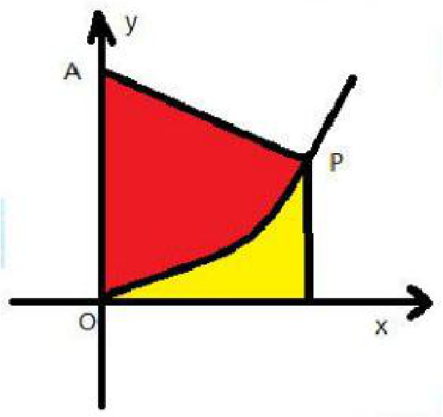

【解析】所求面积为梯形减去曲边三角形的面积，令 $P\left(x,\frac{4}{9} x^2\right)$，则该面积为$S = \frac{1}{2} x\left(\frac{4}{9} x^2 + 1\right) + \int_0^x \frac{4}{9} t^2 dt = \frac{2}{27} x^3 + \frac{1}{2} x$ 而 $\frac{dS}{dt}\bigg|_{x=3} = \frac{dS}{dx}\frac{dx}{dt}\bigg|_{x=3} = 4\left(\frac{2}{9} x^2 + \frac{1}{2}\right)\bigg|_{x=3} = 10$

