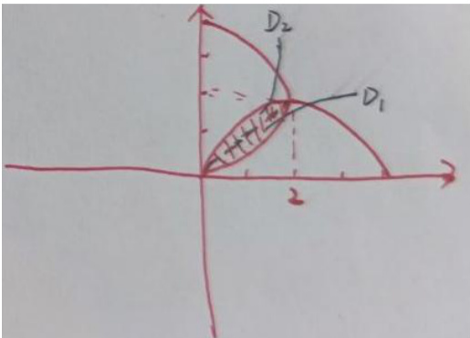

【答案】 $12\pi -\frac{16}{3}$

由题可知，积分区域 $D = \{(x,y)|(x - 2)^2 +y^2\leq 2^2,x^2 +(y - 2)^2\leq 2^2\}$

对应图形为右图所示，

显然积分区域关于 $y = x$ 对称记 $D_{1} = \left\{(x,y)\mid x^{2} + (y - 2)^{2}\leq 2^{2},y\leqslant x\right\}$

$$
D _ {2} = \left\{(x, y) | (x - 2) ^ {2} + y ^ {2} \leqslant 2 ^ {2}, y \geqslant x \right\}
$$

故 $I = \iint_{D}(x - y)^{2}dxdy = \iint_{D_{1}}(x - y)^{2}dxdy + \iint_{D_{2}}(x - y)^{2}dxdy$ $= 2\iint_{D_1}(x - y)^2 dxdy$

令 $x = r\cos \theta .y = r\sin \theta$ 则在积分区域 $D_{1}$ 上有 $\left\{ \begin{array}{l}0\leqslant r\leqslant 4\cos \theta \\ 0\leqslant \theta \leqslant \frac{\pi}{4} \end{array} \right.$

$$
\iint_ {D _ {1}} (x - y) ^ {2} d x d y = \iint_ {D _ {1}} \left(x ^ {2} + y ^ {2} - 2 x y\right) d x d y = \int_ {0} ^ {\frac {\pi}{4}} d \theta \int_ {0} ^ {4 \cos \theta} \left(r ^ {2} - 2 r ^ {2} \cos \theta \sin \theta\right) r d r
$$

$$
= \int_ {0} ^ {\frac {\pi}{4}} d \theta \int_ {0} ^ {4 \cos \theta} \left(r ^ {3} - 2 r ^ {3} \cos \theta \sin \theta\right) d r = 6 \pi - \frac {8}{3}
$$

故 $I = 2(6\pi -\frac{8}{3}) = 12\pi -\frac{16}{3}$
