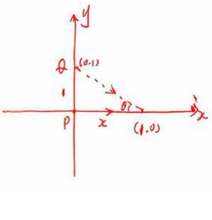

其中r为两质点间的距离.

旦由图可知 $r^2 = x^2 +1$

又引力 F 在 x 方向上的力投影为 $F_{x} = F \cos \theta = \frac{x}{\sqrt{1 + x^{2}}} F$ .

故克服引力做功为:

$$
W = \int_ {0} ^ {1} F _ {x} \mathrm{d} x = \int_ {0} ^ {1} \frac {G}{(x ^ {2} + 1)} \frac {x}{\sqrt {1 + x ^ {2}}} \mathrm{d} x = \int_ {0} ^ {1} \frac {G x}{(1 + x ^ {2}) ^ {\frac {3}{2}}} \mathrm{d} x
$$

