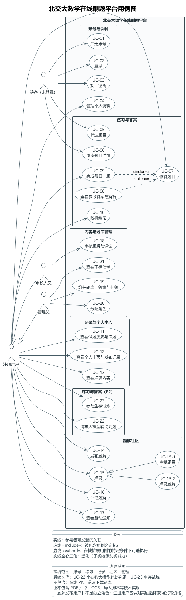

# 北交大数学在线刷题平台 · 需求分析文档

> 版本说明（2026-11-12）：正文按当前程序规则修订；首期排期与抽取试跑数据保留为历史背景，不代表当前题库规模或待开发清单。AI 判题与生存模式仍属后续开发范围，排期见 [后续开发计划](../后续开发计划（10-15周）.md)。

## 1. 项目背景与业务问题

### 1.1 一句话定位

面向北京交通大学学生的**免费数学在线刷题与题解分享网站**，把"筛选题目 → 完成练习 → 核对答案 → 分享题解 → 回顾错题"连成一条完整的学习闭环。首期交付适配电脑与手机浏览器的 Web 站点。

### 1.2 为什么做：真实存在的四个业务问题

| 编号 | 业务问题 | 现状证据（来自题库整理过程） | 造成的学习损失 |
| --- | --- | --- | --- |
| BP-1 | **历年真题散落在 PDF 里，无法按知识点检索** | 仓库 `resource/` 下 147 份试卷文件分散在「北交大历年期末真题」「数学竞赛历年题目及解析」「考研数学（一/二/三）」等多层目录中，题目与答案往往还在不同文件内（`answer_link_report.json` 显示仅有 11 份独立答案源可与题干对应） | 学生想"练 2024 年线代期末题"，只能整份翻 PDF，无法只抽其中一类 |
| BP-2 | **做题没有状态，错了的题下次还会错** | 纸笔/PDF 练习不保存"我做过哪些题、哪道错了、错了几次" | 复习时无法聚焦错题，重复劳动集中在已经会的题上 |
| BP-3 | **没有坚持练习的机制，刷题断断续续** | 现有材料（PDF 试卷包）**在形式上不具备**任何每日目标、进度可见或正反馈机制（无打卡概念、无"今日已完成"状态） | 学习节奏依赖个人自律，考前突击覆盖不足 |
| BP-4 | **有解题想法却没有地方沉淀** | 优质题解散落在个人笔记、班群聊天记录里，随时间失效；低质量答案（含未标注来源的解析）反而更容易被传播 | 集体智慧无法积累，后来者重复踩坑 |

### 1.3 我们的解法与设计主张

1. **结构化题库为先**：先解决"题目能不能被筛出来"。本地整理题目、答案、题型与标签，通过清单导入；公开题面使用 Markdown + LaTeX，原始截图保留供维护核对。有效题目默认发布，缺漏材料进入待补队列，用户反馈后管理员核查；**不把抽取与 OCR 放进用户的在线请求链路**，不设置难度评级。
2. **状态即激励**：每道题只维护一条"当前练习状态"（最近结果、是否曾做对、是否曾做错、最近作答时间），不统计重做次数。做对时给出轻量动画反馈，把"坚持"变成可见的进度。
3. **先作答，后核对**：登录后提交作答或点击“不会”才能解锁参考答案，由后端校验；再次进入、刷新或重做默认折叠，已解锁权限保留。不将此规则视为完整的防作弊机制。
4. **题解资格与做题经历绑定**：只有曾做对当前题目版本的用户才能发布题解（普通填空、解答题以自评正确为准），同版本后来做错不撤销资格。
5. **免费但不越界**：仅收录已核实使用权限的官方公开材料，入库与再分发分别记录依据。

### 1.4 业务目标与衡量指标

| 目标 | 衡量指标（首期验收基线） |
| --- | --- |
| G1 让真题"可检索" | 已发布题目 ≥ 人工校验批次；筛选接口在目标网络、20 并发下暖启动 P95 ≤ 1 s |
| G2 让练习"有状态" | 每日一题打卡记录可查；做题历史/错题列表可筛选 |
| G3 让习惯"可持续" | 每日一题按 `Asia/Shanghai` 自然日分配，用户 + 日期唯一；每日最多打卡一次 |
| G4 让题解"有沉淀" | 题解与评论均经审核后公开；点赞/评论通知可查 |

### 1.5 首期范围边界

| 类别 | 明确排除 | 原因 |
| --- | --- | --- |
| 玩法 | 生存模式（血条）、在线 PK | 首期不纳入；生存模式依赖正在开发的 AI 判题模块，在线 PK 另需实时对局设计。生存模式本身不要求长连接 |
| 判题 | AI 自动判定大题对错 | 需要引入模型与成本评估；首期以"系统给答案 + 用户自评"落地，后续接入时保留用户批驳权 |
| 技术 | 原生 App | 首期以响应式 Web 覆盖手机浏览器 |
| 商业化 | 任何付费/会员/广告 | 定位为校园免费公益项目 |
| 数据 | 收集"全部历年试卷" | 题库规模以第五周前能完成**人工校验**的批次为准，不以数量为上线前提 |
| 统计 | 重做次数、累计提交次数 | 明确的排除项，避免把练习异化为刷次数 |
| 流水线 | PDF 抽取、OCR、去重合并的在线化 | 属本地脚本职责，不面向在线用户 |

***

## 2. 用户角色与需求

### 2.1 用例图



图像保留原渲染稿；修订后的角色关联及新增功能以同目录 `用例图.puml` 和本文规则为准，图像后续统一重新生成。

2.2 参与者总览

图中的 4 个参与者与需求侧的对应关系：

| 参与者 | 图中别名 | 登录态 | 核心诉求 | 首要痛点 |
| --- | --- | --- | --- | --- |
| 游客（未登录） | `guest` | 未认证 | 浏览题面与公开题解后决定是否注册 | 需先了解题目质量 |
| 注册用户 | `registered` | 已登录 | 按条件刷题、每日打卡、保存错题、发布题解、与他人互动 | 练习无状态、无正反馈、题解无处安放 |
| 审核人员 | `reviewer` | 已登录（特殊角色） | 高效处理待审题解与评论，隐藏违规内容 | 人工审核量随内容增长，需要清晰队列 |
| 管理员 | `administrator` | 已登录（特殊角色） | 维护题目/答案/标签，分配角色，追溯审核处理 | 题目质量决定站点口碑，但校错成本高 |

**参与者关系**：注册用户 ← 审核人员、注册用户 ← 管理员；审核人员与管理员**平级且互不继承**；游客与注册用户之间**不画泛化**（登录是同一使用者的状态变化）。

### 2.3 角色 → 用例归属矩阵

| 业务包 | 用例 | 游客 | 注册用户 | 审核人员 | 管理员 |
| --- | --- | :---: | :---: | :---: | :---: |
| 账号与资料 | UC-01 注册账号 | ● |  |  |  |
|  | UC-02 登录 | ● |  |  |  |
|  | UC-03 找回密码 | ● |  |  |  |
|  | UC-04 管理个人资料 |  | ● |  |  |
| 练习与答案 | UC-05 筛选题目 | ● | ● |  |  |
|  | UC-06 浏览题目详情 | ● | ● |  |  |
|  | UC-07 作答题目 |  | ● |  |  |
|  | UC-08 查看参考答案与解析 |  | ●（提交或“不会”后） |  |  |
|  | UC-09 完成每日一题 |  | ● |  |  |
|  | UC-10 随机练习 |  | ● |  |  |
| 记录与个人中心 | UC-11 查看做题历史与错题 |  | ● |  |  |
|  | UC-12 查看个人主页与发布记录 |  | ● |  |  |
|  | UC-13 查看点赞内容 |  | ● |  |  |
| 题解社区 | UC-14 发布题解 |  | ●（曾做对该题） |  |  |
|  | UC-15 点赞（UC-15-1 点赞题目 / UC-15-2 点赞题解） |  | ● |  |  |
|  | UC-16 评论题解 |  | ● |  |  |
|  | UC-17 查看互动通知 |  | ● |  |  |
| 内容与题库管理 | UC-18 审核题解与评论 |  |  | ● | ● |
|  | UC-19 维护题库、答案与标签 |  |  |  | ● |
|  | UC-20 分配角色 |  |  |  | ● |
|  | UC-21 查看审核记录 |  |  |  | ● |
| 已有迭代功能 | UC-24 浏览论坛题解 | ● | ● |  |  |
|  | UC-25 查看更新信箱 |  | ● |  |  |
|  | UC-26 邀请用户并解锁资料 |  | ● |  |  |
|  | UC-27 反馈题目问题 |  | ● |  |  |
|  | UC-28 管理公告与题目反馈 |  |  |  | ● |

UC-21 当前已保存审核日志，独立查询页面仍待完善。审核人员与管理员作为注册用户继承普通使用能力；管理员也能审核内容。新增用例不改变原 UC-01～UC-23 编号。

### 2.4 需求侧痛点与对策（按角色展开）

**A. 游客（未登录）**

| 痛点 | 需求 | 对应用例 |
| --- | --- | --- |
| 注册门槛高，看不到内容就不敢注册 | 筛题、看题和浏览公开题解不强制登录；参考答案需登录并解锁 | UC-05、UC-06、UC-08 |
| 考前只想快速核对某题答案 | 详情接口默认**不携带**标准答案，展开时再单独请求，保证浏览轻量 | UC-06 → UC-08 |

**B. 注册用户**

| 痛点 | 需求 | 对应用例 |
| --- | --- | --- |
| 想按题库类别标签、年份、题型和关键词筛题 | 当前各分类单选、跨条件取“且”；空结果明确提示，不悄悄换范围 | UC-05 |
| 作答后需要核对结果 | 选择题自动判分；填空、解答题提交文字或图片后看参考答案并自评对错 | UC-07 |
| 做错的题散落无从复习 | 每人每题一条最新状态；错题列表在重做正确后**仍保留** | UC-11 |
| 刷题难以坚持 | 每日一题按自然日固定一题、有效作答即自动打卡；做对给动画反馈 | UC-09 |
| 想被题目质量"带着走"而非自己找题 | 在筛选后的题目池中抽题，支持"下一题/重做本题"，尽量避免紧邻重复 | UC-10 |
| 有解法想分享 | 曾做对该题即可发布文字/公式/图片题解；发布后进入审核 | UC-14 |
| 想收藏有意思的题与好题解 | 点赞题目与题解；个人中心"喜欢"页回看（首期"喜欢"兼作收藏，不另建收藏体系） | UC-15、UC-13 |
| 想知道自己的内容有人看 | 题解被点赞或被评论时收到站内通知；自己的操作不通知自己 | UC-17 |

**C. 审核人员**

| 痛点 | 需求 | 对应用例 |
| --- | --- | --- |
| 待审内容多、需要批量处理 | 待审核 / 已通过 / 已隐藏三态；作者可见自己的待审核内容，他人只看已通过 | UC-18 |
| 处理需要留痕、可追溯 | 保留审核对象、操作者、动作、原因与时间 | UC-21（与管理员共见） |

**D. 管理员**

| 痛点 | 需求 | 对应用例 |
| --- | --- | --- |
| 题目抽取质量参差，错题会毁口碑 | 题目状态为草稿 / 已发布 / 已下架；只有已发布且判分配置有效的题目进入练习池 | UC-19 |
| 答案修正后旧判定失效 | 题目内容或答案修正时更新题目 `version`，结合 `problem_version` / `correct_version` 区分旧作答与当前题解资格；纯文字回填按专用流程不增版本 | UC-19 |
| 角色不能自己改 | 角色字段用户不可自改，仅管理员分配 | UC-20、UC-04 |

### 2.5 关键业务规则（需求侧约束）

| 规则域 | 需求约束 |
| --- | --- |
| 筛选 | 对外仅提供题库类别标签、年份、题型、关键词；当前各分类单选，跨条件取“且”；空结果给提示，不换范围。无难度评级；旧难度字段仅作兼容读取，不恢复来源、组别和科目筛选 |
| 每日一题 | 先选择范围，再由用户手动打开当日题目；按 `北京时间`计算 ；用户 + 日期唯一；当天固定一题，**改筛选不换题**；有效作答即打卡，每天最多一次 |
| 随机练习 | 先选择练习范围；按账号和已应用筛选恢复当前题目及编辑草稿，用户主动换题时重新抽取；有其他候选题时避免与上一题紧邻重复 |
| 判题 | 选择题比较选项 ID（多选比较集合）；普通练习中的填空与解答题均为自评。生存模式的 AI 判题另见后续需求 |
| 个人状态 | 每人每题仅一条记录；重做更新原记录，**不增加次数、不留累计流水** |
| 答案可见性 | 登录后提交作答或“不会”才解锁；本次操作后可打开答案，再次进入或重做默认折叠，已解锁者可主动展开；详情接口不直接返回标准答案 |
| 题解资格 | 需曾做对当前题目版本（填空、解答题自评正确同样算）；同版本后续做错不取消资格，题目改版后需重新核对 |
| 内容状态 | 题解/评论：待审核 → 已通过 / 已隐藏；修改后**重新进入审核** |
| 点赞 | 同一用户 + 同一目标唯一，允许取消；并发生成由唯一约束兜底；点赞产生通知 |
| 互动通知 | 首期通过页面刷新或轻量轮询读取，**不建常驻 WebSocket** |
| 隐私 | 做题历史、私人作答、点赞清单默认仅本人可见；公开个人页只展示基础资料与已审核题解 |

***

## 3. MVP 范围与优先级

### 3.1 为什么是 MVP 而不是"全都要"

本项目是课程设计项目，资源约束明确：开发窗口集中在第五周前完成主体、第六至十五周完成至少 3 轮迭代。因此 MVP 的判定标准只有一条：

新用户可完成注册登录、筛题、作答核对与记录回顾；当天分配的每日题完成判分或自评后可打卡。

### 3.2 优先级划分

| 优先级 | 定义 |
| --- | --- |
| **P0** | 缺失则闭环断裂，无法上线验收 |
| **P1** | 闭环可用但体验明显受损，首期目标为"上线前完成" |
| **P2** | 增强项，允许在第六至十五周的迭代中补齐 |
| **Won't** | 明确排除首期 |

### 3.3 MVP 功能清单（P0 必须全部完成）

| 需求编号 | 需求 | 用例 | 优先级 | 验收要点 |
| --- | --- | --- | :---: | --- |
| FR-01 | 邮箱注册 + 邮件验证 | UC-01 | P0 | 验证前受限；重复邮箱被拒 |
| FR-02 | 登录 / 退出 / 会话刷新 | UC-02 | P0 | 刷新后仍在线；退出后受保护页面跳登录 |
| FR-03 | 密码重置（邮件链接） | UC-03 | P0 | 仅未登录可发起；链接过期给出提示 |
| FR-04 | 基础资料管理 | UC-04 | P0 | 当前可改昵称，角色不可自改；头像上传待完善 |
| FR-05 | 组合筛选题目 | UC-05 | P0 | 当前分类单选、跨条件“且”；空结果有提示 |
| FR-06 | 题目详情（公式 + 配图） | UC-06 | P0 | 详情不含标准答案；手机端公式可读 |
| FR-07 | 选择题自动判分 | UC-07 | P0 | 多选按集合比较，顺序不影响判定；选项与正确答案需有效 |
| FR-08 | 填空、解答题提交（文字/图片）+ 自评 | UC-07 | P0 | 结果标注“自评”；未自评显示“待自评” |
| FR-09 | 参考答案与解析（解锁后折叠/展开） | UC-08 | P0 | 提交或“不会”后解锁；再次进入或重做默认折叠 |
| FR-10 | 做题状态保存（仅一条/题） | UC-07 | P0 | 重做覆盖原记录，不产生次数 |
| FR-11 | 做题历史与错题列表 | UC-11 | P0 | 错题重做正确后仍保留 |
| FR-12 | 每日一题 + 打卡 | UC-09 | P0 | 当天固定一题；改筛选不换题；每日最多一次 |
| FR-13 | 随机练习 | UC-10 | P0 | 支持下一题/重做本题；避免紧邻重复 |
| FR-14 | 图片上传（作答附件） | UC-07 | P0 | 经后端校验和转存；仅 JPEG/PNG/WebP；签名直传为后续优化 |
| FR-15 | 题目点赞（兼收藏入口） | UC-15-1 | P0 | 同用户同目标唯一，支持取消 |
| FR-16 | 个人中心（发布/点赞/历史） | UC-12、UC-13、UC-11 | P0 | 私人数据默认仅本人可见 |

### 3.4 P1 功能清单

| 需求编号 | 需求 | 用例 | 优先级 |
| --- | --- | --- | :---: |
| FR-17 | 发布题解（曾做对才可发） | UC-14 | P1 |
| FR-18 | 题解与评论审核（三态） | UC-18 | P1 |
| FR-19 | 点赞题解 | UC-15-2 | P1 |
| FR-20 | 评论题解（一级评论） | UC-16 | P1 |
| FR-21 | 互动通知（刷新/轻量轮询） | UC-17 | P1 |
| FR-22 | 管理员维护题目/答案/标签 | UC-19 | P1 |
| FR-23 | 角色分配 | UC-20 | P1 |
| FR-24 | 审核记录查询 | UC-21 | P1 |
| FR-25 | 做对反馈动画（遵循减少动态偏好） | UC-07 | P1 |

### 3.5 P2 与 Won't

| 项 | 状态 | 说明 |
| --- | --- | --- |
| 邀请用户解锁资料 | **已实现的迭代功能** | 注册后也可绑定邀请码，仅限一位邀请人；云端验证邮箱后绑定计数，邀请两人解锁外部资料链接，不允许自邀 |
| 题库扩充（408、大学物理、他校考题等） | **P2** | 同一套标签与导入流水线可复用，属增量数据工作 |
| AI 判题（大题） | **P2** | 开发计划列为"后续玩法关键"；接入时必须保留用户批驳权 |
| 生存模式 / 在线 PK | **Won't（首期）** | 生存模式已进入后续开发计划，依赖 AI 判题及任务恢复；在线 PK 另行规划，不把首期排除等同于永久不做 |
| 重做次数统计 | **Won't（永久）** | 与产品主张冲突 |
| 付费内容 | **Won't（永久）** | 项目定位为免费公益 |

### 3.6 非功能需求（NFR）

| 编号 | 类别 | 要求 | 验证方式 |
| --- | --- | --- | --- |
| NFR-01 | 性能 | 目标网络、20 并发下，普通查询接口暖启动 **P95 ≤ 1 s**；冷启动、图片上传、外部认证**分别记录**，不混入该指标 | 压测记录（先按基线评估，测试后确认最终指标） |
| NFR-02 | 安全 | 用户不能读取他人私人作答、不能修改他人记录；管理员密钥（service_role / secret）**不得暴露在前端**；答案表不向匿名客户端开放直接查询 | 越权测试用例；前端产物与仓库密钥扫描 |
| NFR-03 | 兼容 | 支持指定版本的 Chrome、Edge，以及手机浏览器 | 浏览器兼容清单 + 手机实机检查 |
| NFR-04 | 可用性 | 手机端题目与公式可正常阅读；核心操作支持键盘；动画遵循系统"减少动态效果"偏好 | 手机布局与公式渲染检查、键盘走查 |
| NFR-05 | 可维护 | 数据库变更有版本记录（SQL migration）；部署有文档；核心业务规则有自动化测试 | `migrations/` 版本对比、测试记录 |
| NFR-06 | 正确性 | 重做后错题保留、曾做对资格不因后来做错而失效、每日跨日与并发分配、重复点赞 —— 均需自动化测试覆盖 | pytest + httpx 测试集 |
| NFR-07 | 可恢复 | 发布记录对应 Git 提交与 migration 版本；应用可回滚至已验证部署；数据库另备数据恢复步骤（数据库变更**不随应用自动回滚**） | 回滚演练记录 |
| NFR-08 | 合规 | 收录与再分发分别核对使用依据；解析如实标注来源，不将平台整理标为官方 | 来源 `rights_note` 与维护记录核查，不视为自动完成的授权认证 |

### 3.7 需求与用例的可追溯性

下表保留首期业务包的映射；后续新增 UC-24～UC-28 见 2.3 节用例矩阵，不计入下表首期数量。

| 业务包 | 用例数 | 覆盖需求编号 |
| --- | :---: | --- |
| 账号与资料 | 4 | FR-01 ~ FR-04 |
| 练习与答案 | 6 | FR-05 ~ FR-14、FR-25 |
| 记录与个人中心 | 3 | FR-11、FR-16 |
| 题解社区 | 7（含 2 个点赞子用例） | FR-15、FR-17 ~ FR-21 |
| 内容与题库管理 | 4 | FR-18、FR-22 ~ FR-24 |

### 3.8 历史抽取试跑：数据前置条件

以下为早期抽取试跑记录（曾引用 `data/problems.json`，6,369 道题），不代表当前程序题库；原始报告不随本次修订重新核验。

| 观察项 | 实测结果 | 对需求的影响 |
| --- | --- | --- |
| `question_type` 取值 | **全部为 `unknown`**，无 `choice` / `fill_blank` / `solution` 等具体题型 | 系统无法判断一道题该走"自动判分"还是"自评" |
| `grading_config_json.kind` 取值 | 抽查范围内**全部为 `self_assessment`** | 即使题型已知，也缺少选项比对与数值误差的判分配置 |

**结论与排期要求**：

1. 当前导入需明确 `choice` / `blank` / `solution` 题型；选择题补齐有效选项与正确答案，填空与解答题使用 `self_assessment`，不安排数值误差自动判分作为当前验收前置。
2. 这一结论与 UC-19 的业务规则完全吻合——"**只有已发布且判分配置有效的题目进入练习池**"，即 AC-02.5 是设计约束而非原则口号。
3. 当前清单校验拒绝未知题型或无效选择题配置，缺漏材料进入待补队列；不以“未知题型自动降级自评”代替有效数据准备。有效题目默认发布，反馈后审核，不要求逐题在管理页预审。
4. 该发现已记录于[产品设计文档的风险项 R-01](产品设计文档.md#54-风险预估与应对)。
5. **自检具有问卷依据**：A.2 第 6 题中 71.05% 的受访者选择“提交后系统给出答案、用户自检并告知系统是否做对”，28.95% 选择大模型判分。这为填空题、解答题采用自评提供了需求侧依据，但不能代替题型标注，也不代表已经验证 AI 判题效果。

***

## 4. 用户故事与验收标准

### 4.1 故事地图

```
注册登录  ──▶ 筛题浏览 ──▶ 作答判分 ──▶ 每日一题 ──▶ 随机练习 ──▶ 查看解析 ──▶ 错题回顾 ──▶ 发布题解
 US-01         US-02         US-03         US-04         US-05        US-06         US-07        US-08
 (P0)          (P0)          (P0)          (P0)          (P0)         (P0)          (P0)         (P1)
```

### US-01 注册与登录（P0 ｜ UC-01、UC-02、UC-03）

**验收标准**

1. **AC-01.1** 邮箱格式非法或该邮箱已注册时，注册被拒绝并给出可理解的中文提示，**不产生半成品账号**。
2. **AC-01.2** 注册后发送验证邮件；**验证完成前**，需要登录态的入口（UC-07、UC-09、UC-10、个人中心）不可用或给出明确原因。
3. **AC-01.3** 验证链接有效期内可完成验证；过期/失效时提示"请重新发送验证邮件"。
4. **AC-01.4** 登录成功后跳回**原访问页面**（如从题目详情页跳登录，登录后回到该题）；刷新页面会话仍然有效。
5. **AC-01.5** 退出登录后，受保护页面立即跳转登录页；浏览器返回按钮不能恢复已登录状态。
6. **AC-01.6** 找回密码仅限"已注册但当前未登录"的用户发起；重置成功后旧会话失效，新密码可登录。
7. **AC-01.7** 密码、token 不出现在日志、URL 查询串或前端 bundle 中。

### US-02 多维度筛选题目（P0 ｜ UC-05、UC-06）

**验收标准**

1. **AC-02.1** 当前题库类别标签、年份和题型分别单选，与关键词组合时取“且”；暂不要求同维度多选。
2. **AC-02.2** 筛选条件可组合、可清空、可分享为 URL（刷新/粘贴链接后结果一致）。
3. **AC-02.3** **结果为空时明确提示"没有符合条件的题目"，不悄悄扩大范围**返回其他题目。
4. **AC-02.4** 列表分页，单页数量有上限；翻页不重复、不遗漏。
5. **AC-02.5** 筛选结果中**只包含已发布（`status = published`）且判分配置有效的题目**；草稿与已下架题目不出现。
6. **AC-02.6** 筛选项限于题库类别标签、年份、题型和关键词；列表项展示题干摘要、题型与标签，长题干截断但可进入详情。
7. **AC-02.7** 查询耗时满足 NFR-01（20 并发下暖启动 P95 ≤ 1 s）。

### US-03 作答与判分（P0 ｜ UC-07）

**验收标准**

1. **AC-03.1** 单选题比较**选项 ID**（不使用展示文本），选项顺序变化不影响判定。
2. **AC-03.2** 多选题按**选项集合**比较，少选或多选判错，顺序不同不影响判定。
3. **AC-03.3** 普通练习中的填空题使用自评，不提供等价表达或数值误差自动判分。
4. **AC-03.4** 填空与解答题提交文字和/或图片后展示参考答案，用户选择“正确/错误”；未选择时为“待自评”，不新增做对资格，同版本此前已获资格不因此撤销。
5. **AC-03.5** 自评结果在界面上标注为"**自评**"，不表述为系统自动判定的客观结论。
6. **AC-03.6** 一道题**未标注题型**或**判分配置无效**时，提交被拒绝并提示"该题暂不可判分"，**不写入错误的判分结果**、不产生个人状态记录。
7. **AC-03.7** 做题状态写入后，用户与题目**仅有一条**当前状态；重复提交覆盖原记录，**不产生次数或累计流水**。
8. **AC-03.8** 做对时给出轻量反馈动画；系统开启"减少动态效果"时该动效降级为静态提示（NFR-04）。
9. **AC-03.9** 判分过程不对用户输入执行 `eval` / `exec` 或任何代码求值（安全红线）。
10. **AC-03.10** 其他用户**无法读取或修改**我的私人作答与做题历史（越权测试覆盖，NFR-02）。
11. **AC-03.11** 选择"不会"后展示参考答案并将题目加入错题列表；不创建作答提交、不触发每日打卡，也不授予题解发布资格；已输入但未提交的草稿保留。

### US-04 每日一题与打卡（P0 ｜ UC-09 → `<<include>>` UC-07）

**验收标准**

1. **AC-04.1** 用户先选择每日一题范围，再手动打开当日题目；系统按当前范围抽取一道题并保存"用户 + 日期 + 题目"分配记录。
2. **AC-04.2** 同日重复进入/刷新**返回同一道题**；分配后修改筛选条件**不更换当天题目**，新条件仅用于随机练习或次日分配。
3. **AC-04.3** 自然日按 `Asia/Shanghai` 计算；**跨日**后进入可获得新的一天题目（跨日边界有自动化测试）。
4. **AC-04.4** "用户 + 日期"存在唯一约束；并发首次请求只产生一条分配记录（并发有自动化测试）。
5. **AC-04.5** 选择题提交有效选项即视为完成；填空与解答题须提交作答**并完成自评**，待自评不打卡。
6. **AC-04.6** **对错不影响打卡**；每天最多打卡一次，重复打卡不产生第二条记录。
7. **AC-04.7** 界面上**没有独立的"打卡"按钮**；打卡完全由有效作答自动触发。首期按首次访问**懒生成**，不依赖常驻定时进程。

### US-05 随机练习（P0 ｜ UC-10）

**验收标准**

1. **AC-05.1** 抽题范围严格等于当前筛选条件的结果集；结果集为空时给出提示且**不返回范围外的题**。
2. **AC-05.2** 提供"下一题"与"重做本题"两个明确动作。
3. **AC-05.3** 当候选题多于 1 道时，"下一题"**避免与上一题紧邻重复**。
4. **AC-05.4** 重做不产生新的记录条数，仍更新同一条个人状态（呼应 AC-03.7）。
5. **AC-05.5** 连续抽题时页面不整页刷新；公式与图片正确渲染（NFR-04）。
6. **AC-05.6** 按账号与已应用筛选恢复当前题目、题干文字、图片引用、选项及题解编辑草稿；恢复后保持当前题目，只有用户主动选择"下一题"时才重新抽取。

### US-06 答案与解析的折叠策略（P0 ｜ UC-08 → `<<extend>>` UC-07）

**验收标准**

1. **AC-06.1** 登录后成功提交作答或选择“不会”才解锁参考答案，后端及受保护媒体入口均校验权限。
2. **AC-06.2** 已解锁用户可主动展开或收起答案；未解锁时提示先提交或点击“不会”。
3. **AC-06.3** 本次提交或“不会”后可打开答案；再次进入、刷新或重做默认折叠，与最近做对或做错无关，解锁权限保留。
4. **AC-06.4** 普通题目详情接口**不直接携带**标准答案；展开时才调用答案接口。
5. **AC-06.5** 游客可浏览题面与已公开题解，不能获取参考答案；登录后仍须满足解锁条件。
6. **AC-06.6** 解析需标明来源；官方未提供解析时显示"**平台整理**"，避免与官方解析混淆。

### US-07 做题历史与错题回顾（P0 ｜ UC-11）

**验收标准**

1. **AC-07.1** 历史列表按最近作答时间排序，展示结果（对/错/待自评）、题型、来源与时间。
2. **AC-07.2** “错题”按当前复习清单显示，答错或“不会”加入；做对不自动移出，历史曾错标记独立保留。
3. **AC-07.3** 后端另支持最近判错口径（`scope=recent_mistakes`）；个人中心当前以练习记录和错题两个入口呈现，不要求新增独立筛选页。
4. **AC-07.4** 历史中**不显示**重做次数或累计提交次数（永久排除项）。
5. **AC-07.5** 列表分页；空状态给出引导（去筛选题目/去做每日一题）。
6. **AC-07.6** 历史与错题数据**仅本人可见**；直接构造他人 `user_id` 的请求被拒绝（越权测试，NFR-02）。
7. **AC-07.7** 用户点击“已掌握，移出错题”只改变清单成员状态，不修改原作答结果、历史标记或答案权限。之后再次答错或选择“不会”时重新加入。

### US-08 发布题解与审核可见性（P1 ｜ UC-14、UC-18）

**验收标准**

1. **AC-08.1** 后端校验登录身份与当前题目版本的做对依据；普通填空、解答题自评正确同样有效，不满足则拒绝并说明原因。
2. **AC-08.2** 未发布的**私人作答**与**公开题解**分开存储；发布必须由用户**明确操作**，做题不会自动把作答公开为题解。
3. **AC-08.3** 题解支持文字、公式与图片；首期每人每题维护**一份**题解并允许编辑。
4. **AC-08.4** 题目内容或答案修正后更新题目 `version`，旧 `problem_version` 作答不作为当前版本做对依据；发布题解检查 `correct_version`，纯文字回填按专用流程不增版本。
5. **AC-08.5** 新发布/修改后的题解状态为"待审核"，**作者本人可见自己的待审核内容**，其他用户**只能看到已通过内容**。
6. **AC-08.6** 审核人员可对题解与评论执行"通过/隐藏"，并记录对象、操作者、动作、原因与时间。
7. **AC-08.7** 被隐藏的内容对普通用户不可见，且**不通过猜测 ID 直接访问**（越权测试覆盖）。
8. **AC-08.8** 题解被点赞或被评论时通知题解作者；**自己的操作不通知自己**；评论审核通过后才通知。

### 4.2 优先级与故事覆盖自检

| 优先级 | 故事 | 数量 |
| --- | --- | :---: |
| P0 | US-01 ~ US-07 | 7 |
| P1 | US-08 | 1 |
| **合计** |  | **8** |

上述 8 条故事保留首期主线编号；新增 UC-24～UC-28 为已有迭代功能，规则补充如下，不宣称旧故事表已完整覆盖所有迭代用例。

- **论坛**：公开汇总审核通过且题目仍发布的题解，按原创建时间倒序、每页 12 篇，支持跳回原题讨论。
- **更新信箱**：登录查看已发布更新，按账号和公告版本记录已读；管理员可发布、编辑、存草稿与隐藏。
- **邀请与资料**：注册后也可手动绑定邀请码，只能绑定一位邀请人且不能自邀；云端先验证邮箱，绑定两名用户后解锁资料，后端每次检查人数。
- **题目反馈**：登录用户反馈题目不完整或答案不匹配，管理员核查并处理；题库默认发布不等于社区内容免审。

### 4.3 小参数大模型辅助判题（UC-22，后续迭代 / P2）

填空题和解答题提交后，注册用户可主动请求模型辅助判断。判题输入仅包括题目、参考答案或评分要点及本次作答，不包含账号 ID、邮箱等身份信息。选择题继续按现有规则自动判分。

模型返回建议正确、建议错误或无法判断，并提供简要理由。建议与用户自评结果分开展示，不覆盖最终作答结果，不触发每日打卡，也不改变题解发布资格。

模型超时、拒答、响应不可用或无法判断时，保留已提交作答和参考答案入口，用户继续原有自评流程。此功能列为 P2 规划；模型来源、请求字段、调用限制和数据留存规则在实施前确定。

| 验收项 | 标准 |
| --- | --- |
| AC-26.1 | 仅填空题和解答题提供辅助判题入口；选择题继续使用现有自动判分。 |
| AC-26.2 | 用户主动请求后显示建议状态和简要理由，并明确标注为模型建议。 |
| AC-26.3 | 模型建议与用户最终自评分开展示、记录；建议不得覆盖自评。 |
| AC-26.4 | 模型不可用或无法判断时不丢失作答，用户可继续查看参考答案并自评。 |
| AC-26.5 | 请求不包含邮箱、账号 ID 等直接身份字段；模型调用不改变打卡、答案解锁和题解资格规则。 |
| AC-26.6 | 辅助建议只对应本次题目版本和已提交作答；题目版本或作答更新后，旧建议不得用于新作答，用户可重新请求或继续自评。 |
***

## 附录 A. 调研记录

### A.1 调研方式

| 方式 | 对象/范围 | 主要产出 |
| --- | --- | --- |
| **问卷调研** | 目标用户（本校在读学生为主），8 题，38 份有效答卷 | 需求优先级实证：做题动机、最想要的试卷类型、判分方式接受度、游戏模式排序（见 A.2） |
| 竞品与参照分析 | 通用刷题类产品（题库检索 + 做题记录 + 社区题解的三段式结构） | 确认"筛选 → 作答 → 题解"是本类产品的通用骨架；确认**不引入**重做次数统计 |
| 材料盘点 | 仓库 `resource/` 下的 147 份试卷文件 | 来源分布、题型分布、是否含官方解析 |
| 数据可行性试跑 | 本地抽取 + 去重 + 答案关联脚本 | 用真实数字验证"题库可结构化"这一核心假设（见 A.3） |

### A.2 用户问卷调研（38 份有效答卷）

**调研设计**：一份 8 题的短问卷（单选 / 多选 / 排序题混排），投放在项目组周围的学生群体中，题目措辞刻意口语化以降低填写门槛。全部 8 题的有效填写人次均为 **38**，即无中途放弃。

#### 逐题结果

| 题 | 问题 | 结果（选项 / 小计 / 比例） |
| --- | --- | --- |
| 1 | 你喜欢学数学吗（单选） | 喜欢 13 / 34.21%；不喜欢 18 / 47.37%；**啥笔才喜欢 7 / 18.42%** |
| 2 | 你目前需要学数学吗（单选） | 需要 25 / 65.79%；不需要 13 / 34.21% |
| 3 | 你大几了（单选） | 大一 2 / 5.26%；大二 6 / 15.79%；**大三 27 / 71.05%**；大四 2 / 5.26%；研究生 1 / 2.63% |
| 4 | 希望平台上准备哪些**数学**题目（多选） | 往年考研真题 31 / 81.58%；往年本科期末试题 27 / 71.05%；往年 CMC 竞赛真题 23 / 60.53%；往年离散数学真题 23 / 60.53%；中高考题目 5 / 13.16%；其他非数学科目 0 / 0%（并留了一句"请注意历年考题是否允许放出"） |
| 5 | 希望准备哪些**非数学**类题目（多选） | **英语四六级 31 / 81.58%**；408 真题 24 / 63.16%；英语考研真题 23 / 60.53%；大学物理真题 17 / 44.74%；算法分析设计真题 15 / 39.47%；其他 1 / 2.63% |
| 6 | 大题直接判对错较困难，哪种方式更合适（单选） | **提交后系统给出答案、用户自检并告知系统是否做对 27 / 71.05%**；引入大模型判断对错（可能出错）11 / 28.95% |
| 7 | 按喜好给游戏模式排序（排序题） | 每日一题·打卡式随机做题 **3.47**；生存模式（血条 / 答错有惩罚）3.32；随机刷题·可连续做题 3.18；在线 PK 2.16 |
| 8 | 题库下载链接作为"邀请新人注册"的奖励，你愿意吗（单选） | 我非常愿意 14 / 36.84%；我愿意 16 / 42.11%；"根本就没有这种交易！" 8 / 21.05% |

#### 从问卷里读出的六条结论

1. **痛点不是"不会"，而是"没有正反馈"**：第 1 题里"不喜欢"占 47.37%、"啥笔才喜欢"占 18.42%，而第 2 题中"需要"占 65.79%——**需求是刚性的，动机不是**。这正是本项目立项的业务前提（BP-1 / BP-3），也说明产品必须提供**可感知的完成与进步**，而不只是又一个题库。
2. **"需要数学 × 不喜欢数学"是最大的一群**：两题交叉后，明显偏向"需要但不享受"的占多数。因此产品目标不能设成"让用户喜欢数学"，只能设成**让每次做题有明确回报**（对应 [产品设计文档](%E4%BA%A7%E5%93%81%E8%AE%BE%E8%AE%A1%E6%96%87%E6%A1%A3.md) 2.4 节旅程 A 的 MVP 判定标准）。
3. **最想要的是"试卷类"内容，而且首选项不是本校期末卷**：第 4 题里考研真题（81.58%）高于本科期末试题（71.05%）。这对**内容收录优先级**提出了与直觉相反的信号——期末卷是数据可得性最高的，但不是用户最想要的。
4. **用户自己就要求核实版权**：问卷提醒核实试卷是否允许发布，支持记录来源及使用依据；当前维护于来源说明和相关记录，不表示运行库已有 `rights_status` 字段。
5. **首期暂不纳入大模型判分、PK 和生存模式**：第 6 题 71.05% 选择"用户自检"，第 7 题"在线 PK"以 2.16 分垫底、生存模式 3.32 分也未进第一梯队。数据**直接支持**把这两类功能排除出首期——与 3.5 表中「生存模式 / 在线 PK → Won't（首期）」的结论一致，只是现在有了数据依据而非仅靠主观取舍。
6. **每日练习与邀请资料有需求基础**：第 7 题偏好与每日一题、随机练习方向一致；第 8 题有 78.95% 表示愿意参与邀请。邀请资料早期列为 P2，现已实现注册后绑定及两人解锁，不再描述为尚待评估。

#### 本次调研的方法局限（务必在评审时如实说明）

- **样本量小且非概率抽样**：38 份，主要来自项目组周边同学，不能外推到全校；第 3 题显示 71.05% 为大三学生，年级结构明显偏斜。
- **只测了"自报偏好"**：没有行为数据，无法区分"想要"和"会用"。第 7 题问卷把"每日一题"与"打卡式随机做题"写在同一选项里，两个功能的偏好无法拆开衡量。
- **问卷措辞偏口语、带表情包**（如第 1 题的"啥笔才喜欢"、第 8 题的"根本就没有这种交易！"），刻意降低了填写压力。上表**保留原始措辞**以便与问卷后台核对；正式引用时应改写为中性表述。
- **第 1、2 题的比例自洽性需注意**：第 1 题比例为 34.21 / 47.37 / 18.42（分母 38，合计 100%），与第 2 题的 65.79 / 34.21 互为镜像，属问卷星保留两位小数的结果，未做四舍五入修正。

> **因此**：以上数字只作为**方向性证据**，用来支持"做哪个、先做哪个"的判断；它们**不足以**支撑任何量化目标（例如"要把不喜欢率降到 X%"）。若需量化结论，应在迭代中补做更大样本、含行为埋点的调研。

### A.3 材料盘点的真实数字（来自 `data/` 报告）

> 这些数字是**早期抽取试跑的中间结果**，不是当前上线题库规模。当时试跑记录为 `draft`、`requires_review = 1`；当前清单与程序不使用这套预审字段，不能据此判定现有题目均待审核。下表及样例保留为历史引用，原始报告未在本次重新核验。

| 指标 | 数值 | 来源文件 |
| --- | --- | --- |
| 纳入抽取的试卷文件 | 141 | `data/import_report.json` |
| 源目录扫描边界排除的月考文件 | 6 | 同上 |
| 抽取到的题目总数 | 6,912 | 同上 |
| 抽取问题条目（短片段等） | 986 | 同上，明细见 `待处理/首次未识别资源/` |
| 标签总数（`dimension + name` 组合） | 59 | 同上 |
| 去重前 / 去重后题目数 | 6,912 → 6,369 | `data/dedup_report.json` |
| 合并掉的重复题 | 543（重复组 382） | 同上 |
| 多来源题目（同题多出处，已合并来源链接） | 347 | 同上 |
| 待人工复核的边界重复对 | 19 | 同上 |
| 可用作答案源的独立文件 | 11 | `data/answer_link_report.json` |
| 由答案源补齐的答案条数 | 57 | 同上 |
| 旧版 `.doc` 通过 Apache Tika 补抽 | 52 / 52 成功 | `data/legacy_doc_report.json` |

**从数字里读出的三条结论**：

1. **“结构化”可行，但需要质量核对**：历史试跑显示存在重复与抽取问题。当前采用清单校验、缺漏待补和用户反馈后的管理员核查；有效题默认发布，不要求逐题后台预审。
2. **历史试跑的答案覆盖曾不足**：11 份答案源、57 条补齐仅说明该次抽取效果，不能推断当前题库缺答案。平台参考答案与公开题解分别维护，并如实标注解析来源。
3. **多来源整理有价值**：历史试跑记录可供后续去重参考；当前题目使用 `source_id` 关联来源及 `tags` 数组，不把旧试跑中的关联表当作运行库已有结构。

**标签维度实测**（直接读 `data/problems.json` 的 `tags[].dimension`）：

| 维度 | 含义 | 实测取值示例 |
| --- | --- | --- |
| `difficulty` | 难度 | `难度3星`（对应 `problems.difficulty` 1–5） |
| `subject` | 科目 | `高等数学`、`线性代数`（概率论与数理统计同类） |
| `year` | 年份 | `2016年`、`2024年`、`2025年`（**一题可挂多个年份**，见去重合并） |
| `source` | 来源 | 与 `source_kind` 对应的来源标签，**去重合并后追加**（故晚出现的题目记录才带该维度） |

### A.4 结构化样例（抽取现状的真实形态）

以下为早期 `data/problems.json` 抽取样例，不是当前导入清单或运行库字段，不可直接据此生成迁移或导入。保留样例以说明历史文本抽取问题：

```json
{
  "id": "f403e9aedf1fd8cb36a9f3d0",
  "question_type": "unknown",
  "content_markdown": "1、已知A 是行列式值为 ... 的3 阶矩阵 ... 则 k 【B】.",
  "options_json": "[{\"id\":\"A\",\"text\":\"3\\n2\\n\"}, ...]",
  "standard_answer": null,
  "grading_config_json": "{\"kind\": \"self_assessment\"}",
  "explanation_source": "unavailable",
  "difficulty": 3,
  "status": "draft",
  "requires_review": 1,
  "tags": [
    {"dimension":"difficulty","name":"难度3星"},
    {"dimension":"subject","name":"线性代数"},
    {"dimension":"year","name":"2024年"},
    {"dimension":"year","name":"2025年"}
  ]
}
```

**可读出的现状问题**（正是需求要解决的）：

- 历史样例的 `question_type = unknown` 需要核对；当前清单必须明确题型，不直接接收未知题型。
- 历史样例缺少标准答案；当前选择题必须具备有效选项和正确答案，不以自评替代选择题配置，填空与解答题按当前规则自评。
- 公式与选项文本被抽取为逐行片段（如 `"3\n2\n"`）：确认了"PDF 文本抽取不等于公式还原"，因此**人工校验批次 + KaTeX 渲染**是必要环节。

***

## 附录 B. 术语表

| 术语 | 英文 / 字段 | 定义 |
| --- | --- | --- |
| 游客 | guest | 当前未认证的访问者，可筛题、看题及公开题解，不能直接查看参考答案 |
| 注册用户 | registered | 已登录使用者，具备做题、打卡、点赞、评论等能力 |
| 审核人员 | reviewer | 负责通过/隐藏题解与评论的角色，与管理员平级 |
| 管理员 | administrator | 维护题库、答案、标签，分配角色，查看审核记录 |
| 曾做对 | `ever_correct` / `correct_version` | 历史曾对标记与做对版本分别保存；发布题解须做对当前版本，同版本后来做错不撤销资格 |
| 曾做错 | `ever_incorrect` | 历史曾错标记；当前错题列表另由 `user_mistakes.active` 控制 |
| 待自评 | pending self-assessment | 解答题已提交但未选择对错的状态，不获得题解发布资格 |
| 自评 | self-assessment | 普通练习中由用户判断填空、解答题对错，结果标注为“自评” |
| 打卡 | daily check-in | 完成当日每日一题的有效作答后自动产生的记录，不是独立按钮 |
| 每日一题 | daily assignment | 按 `Asia/Shanghai` 自然日为"用户 + 日期"分配的一道固定题目 |
| 判分配置 | `grading_mode` | 当前为 `choice` 或 `self_assessment`，选择题另配置选项和正确选项 |
| 题目版本 | `version` | 内容与答案维护使用的版本，结合 `problem_version`、`correct_version` 识别旧作答与题解资格 |
| 题解 | solution | 用户发布的解题过程（文字/公式/图片），审核通过后公开 |
| 待审核 / 已通过 / 已隐藏 | pending / approved / hidden | 题解与评论的三态；作者可见自己的待审核内容 |
| 喜欢 | like | 首期兼作收藏入口的点赞，不另建收藏体系 |
| 稳定题目 ID | `id` | 当前导入和更新的匹配键；保持 ID 稳定，默认保护网页人工修订 |
| MVP | Minimum Viable Product | 最小可用版本，判定标准见 3.1 |
| P0 / P1 / P2 | — | 优先级，定义见 3.2 |
| RLS | Row Level Security | 数据库行级安全；注意服务端 `service_role` 凭证**可绕过** RLS，业务授权仍由后端完成 |
| 迁移 | migration | 版本化 SQL 结构变更，见 `supabase/migrations/` |

***

## 生存模式需求（UC-23，后续迭代）

生存模式依赖稳定的 AI 判题能力，以下为规划需求，尚未纳入首期交付。生命值和最低题量为试玩值，后续根据试玩结果调整。

1. 登录用户选择题库标签、年份和题型后开始挑战；候选题不足 10 道时提示扩大范围。每个账号同时只保留一轮进行中的挑战，本轮题目不重复。
2. 初始生命为 8，上限为 10，生命归零时结束。选择题和填空题答对增加 0.5，答错或选择“不会”减少 1；解答题答对增加 1.5，答错或选择“不会”减少 0.5。
3. 选择题按正确选项判分，填空题和解答题由 AI 判题。判题中、判题失败或需要复核时不结算生命和成绩；用户不能自行改判取得计榜成绩。
4. 支持离开后恢复挑战。题目作废不扣血；重复提交或重试不得重复结算。用户可对结果提出复核，复核期间暂停挑战并暂不计榜，确认误判后本轮不计榜。
5. 挑战结束后展示通过题数、正确率、剩余生命和结束原因。周榜、月榜和总榜按预设题库范围及规则版本分别统计，以通过题数为主要成绩；未解决判题或复核的挑战不计榜。
6. 生存模式不产生每日打卡。按当前题目版本判定正确后可获得题解发布资格；普通练习仍按原有规则自评。

**本次变更说明：**依据生存模式设计方案补充玩法、判题、异常处理和成绩规则，保留后续迭代定位。

***

## 附录 C. 变更记录

| 版本 | 日期 | 变更人 | 变更内容 | 依据 |
| --- | --- | --- | --- | --- |
| v0.1 | 第二周（开发计划定稿） | 项目组 | 以 [项目开发计划](../do-math-problem-online%E9%A1%B9%E7%9B%AE%E5%BC%80%E5%8F%91%E8%AE%A1%E5%88%92.md) 为基线，明确项目目标、功能范围、角色与不包含范围 | 开发计划 一、二章 |
| v0.2 | 用例图完成后 | 项目组 | 角色模型收敛为 4 个参与者；确认"题解发布用户"不是独立角色；用例拆解为 21 个（+2 个点赞子用例） | [用例图](用例图.png) |
| v0.3 | 题库抽取试跑后 | 项目组 | 依据真实数据（6,912 → 6,369）确认"人工校验闸门"与"平台整理解析"为必要需求；确认多标签、多来源模型 | 附录 A.3 |
| **v1.0** | **本文档** | **项目组** | **补齐需求分析文档：背景与业务问题、角色与需求、MVP 与优先级、8 条用户故事与验收标准、调研记录/术语/变更记录** | **本任务（`docs/任务.txt`）** |
| v1.1 | 问卷统计结果到位后 | 项目组 | 新增 A.2「用户问卷调研」（8 题 / 38 份有效答卷）：逐题结果文字化 + 六条结论；据此确认"动机缺口"业务前提、试卷类内容优先级与自检式判分。原 A.2–A.4 顺延为 A.3–A.5。原始统计截图不放入文档，随答辩材料单独提交 | 问卷星统计导出 |
| v1.2 | 2026-11-11 | 项目组 | 合并本轮需求迭代：补充公开筛选范围、每日一题手动打开、随机练习草稿恢复、"不会"与错题移出规则；并补充 UC-22 辅助判题和 UC-23 生存试炼的后续迭代需求。 | 本次需求迭代 |
| v1.3 | 2026-11-12 | 项目组 | 统一答案解锁、填空自评、打卡、错题清单、版本和上传规则；补充已有功能，标明历史数据与后续规划边界。 | 当前程序及已确认规则 |
